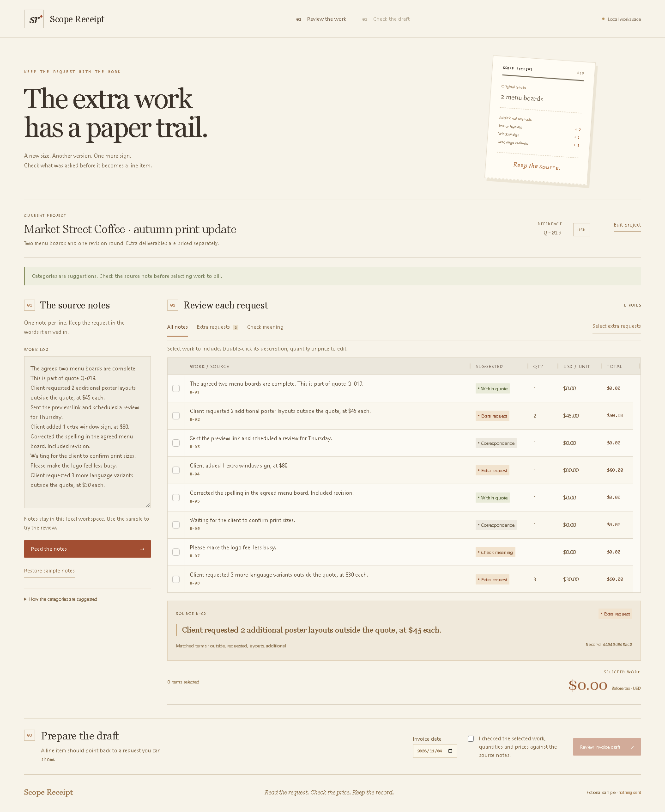

# Scope Receipt

Review work notes, keep the original request beside each proposed line item, and prepare a PayPal invoice draft for the work you select.

**Version 0.1 runs locally. Its PayPal sandbox adapter has been tested with simulated HTTP responses, but no real PayPal account or credentials have been used. Sandbox invoice creation is disabled by default.**



For judges: follow [Run](#run) for the working local review, then [PayPal sandbox setup](docs/PAYPAL-SANDBOX.md) to test the real integration with your own sandbox. No paid service, remote AI key or public hosting is needed. A [demo script](docs/DEMO-SCRIPT.md) separates the local review from the real sandbox footage that is still pending.

## Run

Use Node.js 22.12 or newer. The checked environment uses Node 22.23.4.

```sh
npm ci
npm run build
npm start
```

Open `http://127.0.0.1:4318`. For source editing, `npm run dev` serves the same application with Vite middleware. The production server serves only `dist/`, and listens on the loopback interface.

## Try the sample

1. Read the eight fictional work notes for a coffee shop print update.
2. Inspect an extra request. Its original note and record fingerprint appear below the table.
3. Choose **Select extra requests**. Three selected requests total **USD 260.00**.
4. Check the descriptions, quantities and unit prices. Double-click an editable table cell to change it.
5. Confirm that the selected work was reviewed, then prepare the draft.
6. Download the source-linked Markdown receipt or the PayPal JSON draft.

Editing a source note, quantity, price, date or project detail invalidates the previous review. Missing or ambiguous prices require manual input. A price covering several items is not silently treated as a per-item price.

A price is read from a note only when it is the one clear amount there. `$1,200` and `two extra posters at $40 each` are read in full. A note with two different amounts, a budget or limit, a discount, refund, credit or deposit, an amount with more than two decimals, or a quantity outside 1 to 99 is left at zero with the reason shown, and the draft stays blocked until the operator enters the agreed figures.

**Edit project** changes the project name, quote reference and agreed-scope reminder. The classifier does not interpret that agreement; the operator checks it. Data stays in process/page memory unless explicitly downloaded. There is no account, customer contact, analytics service or remote model call in the local flow.

## The classifier

The model is a multinomial Naive Bayes text classifier using word and word-pair features. It suggests **Extra request**, **Within quote**, **Correspondence**, or abstains with **Check meaning**. It does not select billable work automatically. Proposing billable work is the costly mistake, so **Extra request** needs stronger evidence than the other two; those thresholds were chosen by hand from a small set of sentences.

Training data contains **81 authored synthetic English examples**. Three further authored lists check it, and `MODEL-EVALUATION.json` holds every result:

- A holdout of 12 examples: 12/12 as labelled.
- A harder list of 21: 21 as labelled, none wrongly proposed as billable. These sentences shaped the added examples, so this is a regression list, not a blind test.
- A fresh list of 24, written after the model and thresholds were frozen: 18 as labelled (3 of those are vague notes that should abstain), 5 more abstained, 1 vague note read as "Within quote", none wrongly proposed as billable and no extra request missed.

All of this is small and synthetic, and written by the same author, so none of it estimates accuracy on real client records. Accuracy in actual billing work has not been measured. English phrasing outside the examples, indirect requests and contractual nuance remain limitations.

```sh
npm run train
```

This deterministically recreates `src/model/model.json` and `MODEL-EVALUATION.json`. Training does not download data or contact a model provider.

## PayPal connection

The adapter targets only `https://api-m.sandbox.paypal.com`:

- `POST /v1/oauth2/token` obtains a short-lived token in server memory.
- `POST /v2/invoicing/invoices` creates a draft, with an idempotency reference.

There is no send, charge, capture, refund or live-production endpoint. A local preview must be reviewed before the server can request a draft. A consumed preview is locked against a duplicate request. When PayPal's answer is lost, the application says the draft may or may not exist instead of reporting one, and a retry sends the same `PayPal-Request-Id`, which PayPal documents as returning the original result rather than creating a second invoice. An answer that makes no sense locks the preview for a manual check.

A refusal is reported differently from an unknown outcome. When sign-in fails, or PayPal answers 400, 401, 403, 404, 405, 415 or 422, the application treats the operation as refused: the page shows PayPal's status, error name, field paths, issue codes and debug reference, the server logs the same line, and the preview stays usable. A timeout, an unreadable reply or another unsuccessful response leaves the outcome uncertain; retrying that same open preview reuses its request ID. An unexpected successful response locks the preview for manual inspection. When PayPal's reply includes a total, the page compares it with the reviewed total and says whether they match.

[PayPal's Invoicing troubleshooting guide](https://developer.paypal.com/invoicing/troubleshooting) documents retrying with the original request ID after a timeout or server error. That behavior is simulated in the tests; actual sandbox behavior remains unverified. Preview references live only in server memory and expire after ten minutes. After expiry, a reload or a server restart, inspect the sandbox before preparing another draft; a new preview gets a new request ID. Do not treat the in-memory guard as durable billing storage.

The operator prepares their own sandbox before setting `PAYPAL_CLIENT_ID`, `PAYPAL_CLIENT_SECRET` and `ALLOW_SANDBOX_DRAFTS=1`. Either set them in the process environment and use `npm start`, or copy `.env.example` to `.env`, fill it in and use `npm run start:sandbox`. `npm start` does not load an `.env` file. `.env` is ignored by git. Credentials must never be added to the browser bundle or committed. See [PayPal sandbox setup](docs/PAYPAL-SANDBOX.md) for the exact sequence and acceptance checks.

A first real sandbox draft was created and read back on 2026-11-07 (see [PayPal sandbox setup](docs/PAYPAL-SANDBOX.md)). Timeout and retry behavior against the real service, other merchant settings and the judging setup remain unverified. The current server is for a local workspace. Authentication is required before any future public deployment that enables sandbox mutations.

Official reference: [PayPal Invoicing API v2](https://developer.paypal.com/api/invoicing/v2). Tax, recipient details, discounts and accounting treatment are not calculated by this prototype.

## Validation

```sh
npm test
npm run build
npm run test:ui
```

For the browser tests, install Chromium once with `npx playwright install chromium` if it is not already available. The tests cover exact decimal arithmetic, unchanged source records, manual confirmation, ambiguous amounts, local HTTP behavior and the sandbox adapter with injected responses. Browser checks rebuild the application, then use a local server and headless Chromium with sandbox credentials explicitly empty. They exercise category filters, source inspection, grid editing, project details, preview generation, actual file downloads and a 390 px viewport. A second local server runs the real application and adapter with only PayPal's network answers replaced, so the sandbox button is exercised through success, a total that differs, a missing total, a refusal and an unknown outcome. Generated screenshots stay in `test-results/previews/` inside the project. No check here reaches PayPal.

## Preparing source for publication

```sh
npm run check:public
npm run prepare:public
```

These commands check an explicit set of source files for common credential patterns, email addresses, phone numbers and local file paths. The second command copies that set into a new `release/scope-receipt-.../` folder and adds a SHA-256 file manifest. It copies neither `.env` nor git history, owner notes, logs, build output or installed dependencies, and makes no network request or publication. Review the resulting folder before authorizing a new public repository. Pattern checks do not establish that every kind of private data is absent. Images and claims in the README also require human review.

## Development and licensing

Codex and Claude drafted the code, design, synthetic training data, fictional notes and tests. No real users, clients or transaction data were used. No field performance, saved time or revenue increase is claimed.

The table uses **AG Grid Community 36.2.0**, under its MIT license. No Enterprise package or paid feature is used. The original application code is under the MIT license. Versions are pinned in `package-lock.json`; see [third-party notices](THIRD-PARTY-NOTICES.md).

AG Grid is the review workspace: category filtering, source inspection, row selection and editable descriptions, quantities and prices all feed the reviewed invoice. The hackathon's [AG Grid prize rules](https://paypalaihackathon.devpost.com/rules) cover AG Grid tools. Its [sponsor resource page](https://paypalaihackathon.devpost.com/details/aggrid), however, asks for a polished dashboard and Studio Agent Framework work beyond a standalone grid or chart. This application uses Community and has a weaker fit to that sponsor brief. It does not use Studio or its agent framework. Final eligibility and award decisions belong to the organizers.

The project has not been published or submitted. The PayPal hackathon requires a functioning PayPal integration before an entry can be treated as complete. A functioning sandbox test, public source repository and recorded demonstration remain owner-authorized follow-up work.
